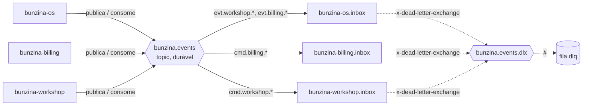

# bunzina-broker

## Propósito

Provisionar, com Terraform e Helm, o RabbitMQ que transporta comandos e eventos da saga entre `bunzina-os`, `bunzina-billing` e `bunzina-workshop` ([ADR 0015](https://github.com/Bunzina/bunzina/blob/main/docs/arch/adrs/0015-rabbitmq-broker.md)). O repositório cria o broker dentro de um cluster Amazon EKS existente, com a topologia da saga já carregada.

Ele depende do [bunzina-infra](https://github.com/Bunzina/bunzina-infra), que cria o cluster. A ordem de implantação é **bunzina-infra → [bunzina-db](https://github.com/Bunzina/bunzina-db) → bunzina-broker → serviços**. Este repositório lê o nome do cluster no estado remoto do `bunzina-infra`.

## Tecnologias utilizadas

| Tecnologia | Uso neste repositório |
| --- | --- |
| Terraform >= 1.11 | Infraestrutura como código; o workflow utiliza 1.11.4 |
| Provider AWS `~> 5.0` | Consulta dos dados do cluster EKS |
| Provider Helm `~> 2.0` | `helm_release` do RabbitMQ |
| Helm (chart local `charts/rabbitmq`) | StatefulSet, Services, ConfigMap e Secret do broker |
| RabbitMQ 3.13 (`rabbitmq:3.13-management`) | Broker; a mesma imagem do `docker-compose` dos serviços |
| Amazon S3 | Estado Terraform deste projeto e leitura do estado de `bunzina-infra` |
| GitHub Actions | Plano em pull requests e deploy manual |

## Arquitetura



O release `bunzina-rabbitmq` roda no namespace `rabbitmq`, separado do namespace do PostgreSQL, que pertence ao `bunzina-db`. É um nó único (sem HA), com volume persistente. A interface de gerenciamento (`15672`) e as métricas Prometheus (`15692`) ficam apenas no Service interno.

O chart é próprio, e não o do Bitnami, porque as imagens `docker.io/bitnami/*` usadas por ele foram retiradas do Docker Hub.

### Topologia

Carregada como *definitions* no boot, a partir de `topology` em [`charts/rabbitmq/values.yaml`](charts/rabbitmq/values.yaml):

| Fila | Bindings na exchange `bunzina.events` (topic, durável) |
| --- | --- |
| `bunzina-os.inbox` | `evt.workshop.*`, `evt.billing.*` |
| `bunzina-billing.inbox` | `cmd.billing.*` |
| `bunzina-workshop.inbox` | `cmd.workshop.*` |

Cada fila tem a DLQ `<fila>.dlq`, ligada com `#` à exchange `bunzina.events.dlx`; a fila aponta para ela por `x-dead-letter-exchange`.

Essas definições precisam permanecer idênticas ao `assertTopology` de cada serviço (`src/infrastructure/messaging/connection.ts`): um argumento a mais em qualquer fila faz o `assertQueue` do serviço falhar com `PRECONDITION_FAILED`. Ao adicionar um serviço consumidor, inclua a fila em `topology.queues`.

O RabbitMQ não cria o vhost nem o usuário padrão quando há definitions para carregar. Por isso o usuário, a senha e as permissões entram nas próprias definitions, guardadas em um Secret do Kubernetes.

## Pré-requisitos

- Terraform >= 1.11, Helm, AWS CLI e kubectl instalados.
- O cluster do `bunzina-infra` já criado, e o bucket do estado dele acessível.
- Credenciais AWS válidas (no AWS Academy, renove-as quando a sessão expirar).
- Uma senha para o RabbitMQ, com no mínimo 8 caracteres.

## Execução e deploy local

### 1. Configurar credenciais e variáveis

```bash
export AWS_ACCESS_KEY_ID="<chave-de-acesso>"
export AWS_SECRET_ACCESS_KEY="<chave-secreta>"
export AWS_SESSION_TOKEN="<token-da-sessao>"
export AWS_DEFAULT_REGION="us-east-1"
export TF_VAR_rabbitmq_password="<senha-do-rabbitmq>"

cp infra/terraform.tfvars.example infra/terraform.tfvars
```

Ajuste `infra/terraform.tfvars` com o bucket do estado do `bunzina-infra` (`bunzina-tfstate-<AWS_ACCOUNT_ID>`). A senha não tem valor padrão e nunca vai para um `.tfvars`.

### 2. Inicializar, validar e planejar

```bash
cd infra
terraform init \
  -backend-config="bucket=$TF_STATE_BUCKET" \
  -backend-config="key=bunzina/broker/dev/terraform.tfstate" \
  -backend-config="region=us-east-1" \
  -backend-config="use_lockfile=true"

terraform fmt -check -recursive
terraform validate
terraform plan
```

### 3. Aplicar e verificar

```bash
terraform apply

aws eks update-kubeconfig --name bunzina-eks --region us-east-1
kubectl -n rabbitmq get pods,pvc
kubectl -n rabbitmq port-forward svc/bunzina-rabbitmq 15672:15672
terraform output
```

## Conexão dos serviços

Dentro do cluster, o secret `RABBITMQ_URL` de `bunzina-os`, `bunzina-billing` e `bunzina-workshop` deve ser:

```text
amqp://bunzina:<senha>@bunzina-rabbitmq.rabbitmq.svc.cluster.local:5672
```

A senha é a mesma de `RABBITMQ_PASSWORD`. O host também sai em `terraform output rabbitmq_amqp_host`.

No ambiente local, o broker é o mesmo `rabbitmq:3.13-management` do `docker-compose.yml` de cada serviço, com usuário e senha `bunzina`; os serviços declaram a mesma topologia ao conectar.

## Deploy pelo GitHub Actions

O arquivo [terraform.yml](.github/workflows/terraform.yml) executa `fmt`, `init`, `validate` e `plan` em pull requests que alteram `infra/**`, `charts/**` ou o próprio workflow, publicando o plano no PR.

1. Disponibilize para este repositório os secrets `AWS_ACCESS_KEY_ID`, `AWS_SECRET_ACCESS_KEY`, `AWS_SESSION_TOKEN`, `AWS_ACCOUNT_ID` e `RABBITMQ_PASSWORD`. Se algum estiver no nível da organização, o repositório precisa estar na lista de acesso dele.
2. Revise o plano do pull request.
3. Em **Actions → Terraform → Run workflow**, selecione a referência desejada e inicie a execução manual.
4. O job de aplicação utiliza o ambiente GitHub `production` e executa `terraform apply -auto-approve -input=false`.

O workflow utiliza Terraform 1.11.4, região `us-east-1`, bucket `bunzina-tfstate-<AWS_ACCOUNT_ID>` e chave `bunzina/broker/dev/terraform.tfstate`. Ele lê o estado de `bunzina-infra` na chave padrão `bunzina/infra/dev/terraform.tfstate`.

## Operação e remoção

A alteração da topologia em `charts/rabbitmq/values.yaml` muda o Secret das definitions e reinicia o pod pelo checksum. Os argumentos de uma fila que já existe no volume não mudam depois de criada; para alterá-los, apague a fila ou recrie o volume.

Remova primeiro os serviços que usam o broker. Depois execute `terraform destroy` em `bunzina-broker/infra`. O StatefulSet apaga o próprio PVC, e portanto o volume EBS, na remoção.
